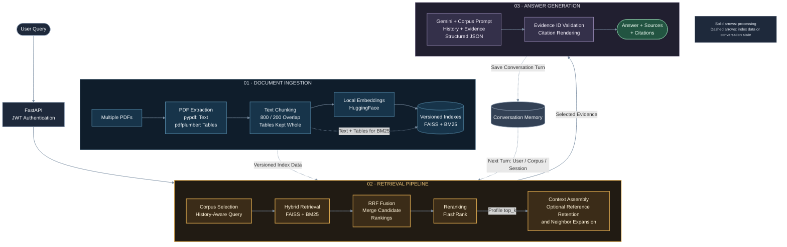

# 🤖 RAG Agent — Multidocument Nutritional Labeling (Argentina)

<p align="center">
  
</p>

<p align="center">
  
  
  
  
  
  
  
</p>

**API RAG conversacional con corpus independientes** para consultar documentación regulatoria argentina: rotulado frontal y Capítulo II del Código Alimentario Argentino. El agente que selecciona herramientas automáticamente es la arquitectura objetivo; actualmente la selección de corpus es explícita.

- 🔍 Local retrieval (FAISS + HuggingFace embeddings, zero cloud costs)
- 🧠 Generation via Gemini API (free tier, no credits required)
- 📄 Multidocument ingestion — index and query across multiple PDFs simultaneously
- 📊 Evaluación RAGAS sobre respuestas guardadas y replays trazables por corpus; no es una certificación de producción
- ⚡ FastAPI with local Docker build support

---

## Verified Status — 2026-10-21

- **Two indexed corpora:** Argentine Food Code and front-of-pack labeling, each with independent indexes, retrieval profiles and versioned prompts.
- **Integrated hybrid retrieval:** FAISS + BM25, RRF fusion and FlashRank reranking, with profile-controlled reference retention and neighboring chunks.
- **27 focused tests passed:** offline embeddings, corpus profiles, explicit references and retrieval.
- **Three real Gemini runs completed:** replay of `c03`, `r05` and `r08`, with all expected pages retained after the context budget.
- **7/7 citations verified for provenance:** matched against the evidence delivered to the generator.
- **Traceable evaluation runs:** recorded questions, responses, evidence, versions and token usage; manifests preserved throughout the replay.

[View replay responses and supporting evidence →](evaluation/AUDITORIA_FONDO_2026-10-21.md)

<details>
<summary><strong>Validation details</strong></summary>

- **Runtime:** `.venv`; local embeddings default to offline mode. `.env` loads before Hugging Face imports, including CLI entry points. Model resources must be provisioned in the local cache.
- **Corpus versions:** `codigo-alimentario-v1` uses profile 4 / prompt v3; `rotulado-v1` uses profile 2 / prompt v2. Each maintains its own index and profile.
- **Context budget:** 20,000 content characters per corpus; headers and instructions are counted separately from this budget.
- **Test scope:** the 27 passing tests cover the focused areas above, rather than the entire test suite.
- **Candidate experiment:** expanding from 15/15 to 50/50 candidates reduced sodium retrieval coverage in the diagnostic set, so the change was not promoted. Advertising retrieval remains unresolved in both variants.
- **Replay protocol:** three successful Gemini calls, at least 35 seconds between starts, no retries and unchanged manifests.
- **Replay review:** `c03` and `r08` cover the main expected elements. `r05` includes the sodium values but omits the explicit “or” between the general criteria. No new RAGAS judge was run for this replay.
- **Scope:** these are documented diagnostic results; production certification remains outside the completed validation.

Reference documentation: [operational state](STATE.md), [architecture](ARCHITECTURE.md), [evaluation protocol](EVAL.md) and [history](HISTORY.md). The legacy project context is not the source of current operational state.

</details>

---

## 🧩 Architecture Flow



**Multidocument:** cada corpus vive en `corpora/<corpus-id>/`, con sus PDFs, su índice
FAISS y su manifiesto. Los corpus no se mezclan entre sí.

---

## Tech Stack

| Component | Technology |
|---|---|
| Retrieval | FAISS CPU 1.15.1 + SQLite FTS5/BM25 + RRF; HuggingFace embeddings (`sentence-transformers/paraphrase-multilingual-MiniLM-L12-v2`) |
| Embedding Runtime | Sentence Transformers 6.1.0 + PyTorch 2.9.0 (CPU) |
| Reranking | FlashRank 0.2.10 (`ms-marco-TinyBERT-L-2-v2`) |
| PDF Extraction | pypdf 5.4.0 (text) + pdfplumber 0.11.6 (tables) |
| LLM | Google Gemini API via `google-genai` 1.16.1; model configured with `GEMINI_MODEL` |
| API | FastAPI 0.143.5 + Starlette 1.9.0 + Pydantic 2.11.3 |
| RAG Components | `langchain-core` 1.6.7, `langchain-huggingface` 1.2.2 and `langchain-text-splitters` 1.1.3; project-owned FAISS adapter (without `langchain-community`) |
| Persistent Memory | SQLAlchemy 2.1.3 + SQLite; optional PostgreSQL/psycopg |
| Evaluation | Custom LLM-as-a-judge: Faithfulness, Answer Relevancy, Context Precision |
| Version Control | Git + GitHub |

---

## Installation

### Requirements

- Python 3.12 (validated runtime)
- pip
- Gemini API key (free tier) from [aistudio.google.com](https://aistudio.google.com/)

```bash
# Clone the repository
git clone https://github.com/bernytech25/rag-agent.git
cd rag-agent

# Create and activate a virtual environment (Windows)
python -m venv .venv
.venv\Scripts\activate

# Create and activate a virtual environment (macOS/Linux)
python3 -m venv .venv
source .venv/bin/activate

# Install dependencies
pip install -r requirements.txt

# For this same .venv to also run RAGAS evaluation and observability tools:
pip install -r requirements-evaluation.in

# Copy the template, fill in Gemini credentials, a 32+ character JWT secret,
# and a bcrypt user hash. Never use default credentials.
cp .env.example .env
```

On Windows PowerShell, use `Copy-Item .env.example .env`. The service fails fast
when `JWT_SECRET_KEY` or `RAG_USERS_JSON` are missing or invalid.


---

## Usage

### Local API (FastAPI)

Start the local development server:

```bash
python -m uvicorn app.main:app --reload
```

Build the container explicitly with the lowercase build file currently tracked by
this repository:

```bash
docker build -f dockerfile -t rag-agent .
```

Los documentos, el índice FAISS y la memoria se conservan fuera de la imagen, en
`corpora/<corpus-id>/`. La imagen es reutilizable; al iniciar el contenedor se
monta el directorio `corpora/` y se elige el corpus mediante `RAG_CORPUS_ID`.

```powershell
docker run -d --name rag-agent-local --env-file .env -p 127.0.0.1:8000:8000 `
  -v "${PWD}\corpora:/app/corpora" rag-agent:corpus-v1
```

El corpus inicial es `rotulado-v1`. Para crear otro, por ejemplo
`codigo-alimentario-v1`, se crea `corpora/codigo-alimentario-v1/documents/`,
se agregan sus PDFs, se genera su índice y se inicia el servicio con
`RAG_CORPUS_ID=codigo-alimentario-v1`. Nunca se eliminan ni se mezclan los
datos del corpus anterior.

Open the interactive API documentation at [http://localhost:8000/docs](http://localhost:8000/docs).

#### Example: `POST /ask`

Request:

```json
{
  "session_id": "consulta-001",
  "question": "What is the sodium limit for the excess sodium warning label?"
}
```

Response:

```json
{
  "answer": "The excess sodium warning label applies when the product exceeds the applicable sodium threshold established by the regulation.",
  "sources": [
    "2024-12-manual_normativa_original..."
  ]
}
```

---

## Evaluation

**RAGAS evaluation across 20 saved responses from two corpora**

> **0.9167 faithfulness · 4.5/5 relevance and coverage · 4/4 contractual abstentions**

Evaluated snapshot: **October 20, 2026**, with 10 responses per corpus. Faithfulness covers the 16 answerable cases; relevance and coverage use case-specific rubrics across all 20 cases.

- **Argentine Food Code:** **0.875** faithfulness and **4.6/5** relevance and coverage.
- **Front-of-pack labeling:** **0.9583** faithfulness and **4.4/5** relevance and coverage.
- **Evaluator execution:** **52/52 requests completed**, with zero provider errors.

[Read the methodology and case-by-case results →](evaluation/ragas_runs/2026-10-20-full/RESULTADOS.md)

<details>
<summary><strong>Methodology and scope</strong></summary>

- **Snapshot-based benchmark:** RAGAS evaluated the saved responses and their recorded evidence. These scores describe that snapshot; later runtime corrections and focused replays are documented separately.
- **Faithfulness:** response claims were evaluated against the saved context for 16 answerable cases.
- **Relevance and coverage:** `InstanceSpecificRubrics` scored the expected behavior on a 1–5 scale. This is a rubric-based assessment, not the standard `answer_relevancy` metric.
- **Abstention:** all four expected abstentions passed the persisted response-contract checks. Semantic review of the explanation remains a separate task.
- **Retrieval:** historical metrics and expected-page labels are available in the linked report. Comparisons must preserve the identity of the dataset and configuration.
- **Earlier evaluation:** the custom LLM-as-a-judge score of 0.862 belongs to a separate initial evaluation. It is not a RAGAS score or a current runtime metric.
- **Coverage checks:** high faithfulness alone does not establish that every critical condition was included, as illustrated by `c02`.
- **Validation strategy:** each corpus needs its own baseline and promotion gate. These small diagnostic sets have also informed adjustments and are not an independent holdout.
- **Next validation work:** a new control set with human review, scoring of `required_claims` and `critical_conditions`, and validation of retrieval metrics.

**Gemini evaluation protocol:** one request at a time, at least 35 seconds between request starts, no automatic retries and stop on HTTP 429. Each case preserves its question, evidence, response or error, versions, timings and token usage. This conservative cadence does not guarantee provider quota availability.

</details>

---

### Table Extraction

**pdfplumber** detects tables automatically and converts them to Markdown. This prevents tables from being split by `CHUNK_SIZE`, preserving the regulatory relationships between labels, thresholds, percentages, and numeric limits.

---

### Prompt Guard

Cada corpus tiene un prompt versionado. La salida estructurada se valida contra los IDs de evidencia recuperados y se renderiza con citas. Este contrato detecta citas ajenas al turno y errores de estructura; no garantiza exactitud semántica, cobertura completa ni ausencia de alucinaciones. Esas propiedades requieren evaluación de respuestas y condiciones críticas.

---

## Roadmap

- [ ] Deploy to Cloud Run
- [ ] Add more regulatory documents (multidocument expansion)
- [ ] Improve Context Precision to 0.75+
- [ ] Implement feedback loop (user validates answers)
- [ ] Production monitoring (query logging)

---

## Credits

- **Evaluación:** RAGAS y herramientas de diagnóstico propias; ver los informes reproducibles en `evaluation/`.
- **Prompt engineering:** Collaboration with Kimi
- **Retriever optimization:** Balanced `CHUNK_SIZE`, `TOP_K`, and reranking

---

## License

MIT

---

## Contact

GitHub: https://github.com/bernytech25/rag-agent

---

## Changelog

**v1.0** (2026-07-30)

- [x] Functional RAG with FAISS + Gemini
- [x] Evaluación inicial custom LLM-as-a-judge: 0.862 (no RAGAS)
- [x] FastAPI deployed locally
- [x] pdfplumber for table extraction
- [x] Guard prompt against number rephrasing
- [x] Full GitHub push
- [x] Multidocument ingestion support
